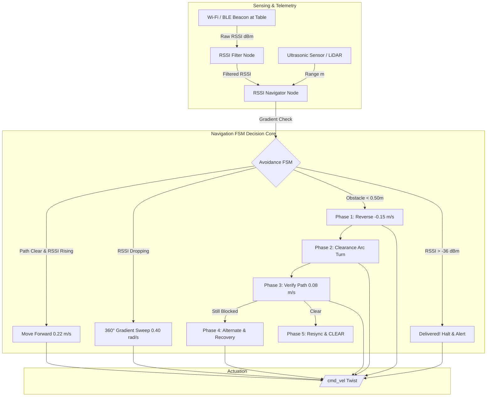

# ROS 2 Mapless Indoor Café Delivery Robot
## Engineering Brief, Mathematical Formulations & Viva Preparation Guide

**Project Title:** Low-Cost Mapless Autonomous Indoor Delivery Robot using RSSI Gradient Tracking & Multi-Phase Reactive Obstacle Avoidance  
**Target Environment:** ROS 2 Humble / Iron / Rolling · Gazebo Fortress · Windows Standalone Digital Twin  
**Workspace Path:** `C:\Users\User\.gemini\antigravity\scratch\ros2_ws\`

---

## 1. Executive Summary & Architecture Overview

Traditional indoor autonomous mobile robots (AMRs) rely heavily on expensive LiDAR sensors (e.g. 16/32-beam 3D LiDARs) and resource-intensive SLAM (Simultaneous Localization and Mapping) pipelines such as Nav2 and Cartographer. While effective in structured warehouses, SLAM introduces high computational overhead, requires pre-computed static feature maps, and fails when tables and chairs are frequently rearranged in a dynamic commercial café.

This project delivers a **cost-effective, mapless alternative**:
1. **Target Beacon Tracking:** The robot navigates toward customer tables using **Received Signal Strength Indication (RSSI)** emitted by a customer's Wi-Fi / BLE beacon token.
2. **Signal Conditioning:** Raw RSSI telemetries suffer from severe multipath fading, shadowing, and RF reflection. An onboard **Exponential Moving Average (EMA)** filter conditions the signal in real time.
3. **Reactive Safety:** A forward ultrasonic sensor array coupled with a **5-Phase Finite State Machine (FSM)** prevents collisions with tables, chairs, and moving pedestrians.
4. **Zero-Setup Windows Digital Twin:** A high-resolution desktop simulation GUI (`cafe_simulator_gui.py`) enables full demonstration on native Windows with **zero WSL / Linux installation hurdles**.



---

## 2. Mathematical Formulations

### A. Radio Signal Propagation Model (Log-Distance Path Loss with Log-Normal Shadowing)
The relationship between received RF signal strength $RSSI(d)$ (in $\text{dBm}$) and distance $d$ (in meters) from the transmitter beacon is modeled by:

$$RSSI(d) = P_0 - 10 \cdot n \cdot \log_{10}\left(\frac{d}{d_0}\right) + X_\sigma$$

Where:
- $P_0$: Received signal strength at reference distance $d_0 = 1.0\text{ m}$ (typically $-32.0\text{ dBm}$ to $-35.0\text{ dBm}$).
- $n$: Path loss exponent ($n \approx 2.0$ in free space; $n \approx 2.4 - 3.0$ in indoor café environments with wooden furniture and human bodies).
- $X_\sigma \sim \mathcal{N}(0, \sigma^2)$: Zero-mean Gaussian random variable representing log-normal shadowing noise caused by multipath reflections ($\sigma \approx 1.8 - 2.5\text{ dB}$).

### B. Signal Conditioning: Exponential Moving Average (EMA)
To smooth Gaussian noise without introducing excessive phase lag:

$$y[k] = \alpha \cdot x[k] + (1 - \alpha) \cdot y[k-1]$$

Where:
- $x[k]$ is the raw noisy RSSI sample at time step $k$.
- $y[k]$ is the filtered output.
- $\alpha = 0.30$ is the smoothing smoothing coefficient (cutoff frequency $f_c \approx \frac{\alpha \cdot f_s}{2\pi}$).

Alternatively, the discrete Boxcar Moving Average across a sliding FIFO window of size $W=10$:

$$\bar{x}[k] = \frac{1}{W} \sum_{i=0}^{W-1} x[k-i]$$

### C. Differential Drive Robot Kinematics
For a two-wheeled differential drive chassis with wheel separation $L = 0.16\text{ m}$ and wheel radius $r = 0.033\text{ m}$:

Given commanded linear velocity $v$ and angular velocity $\omega$:
$$\begin{bmatrix} v_R \\ v_L \end{bmatrix} = \begin{bmatrix} 1 & \frac{L}{2} \\ 1 & -\frac{L}{2} \end{bmatrix} \begin{bmatrix} v \\ \omega \end{bmatrix}$$

Individual wheel angular velocities:
$$\dot{\phi}_R = \frac{v_R}{r}, \quad \dot{\phi}_L = \frac{v_L}{r}$$

---

## 3. Finite State Machine (FSM) Transition Matrix

| Current State | Trigger Condition | Target State | Commanded Motion | Duration |
|---|---|---|---|---|
| **`CLEAR`** | Range $< 0.50\text{ m}$ (Hazard detected) | **`BACK`** | $v = -0.15\text{ m/s}, \omega = 0.0$ | $0.8\text{ s}$ |
| **`CLEAR`** | $RSSI \ge -36.0\text{ dBm}$ (Target reached) | **`DELIVERED`** | $v = 0.0\text{ m/s}, \omega = 0.0$ | Continuous |
| **`CLEAR`** | $RSSI[k] \ge RSSI[k-1]$ | **`CLEAR`** | $v = 0.22\text{ m/s}, \omega = 0.0$ | 100 ms loop |
| **`CLEAR`** | $RSSI[k] < RSSI[k-1]$ (Gradient lost) | **`CLEAR (Sweep)`** | $v = 0.0\text{ m/s}, \omega = 0.40\text{ rad/s}$ | $\approx 15.7\text{ s}$ |
| **`BACK`** | Timer $> 0.8\text{ s}$ elapsed | **`ARC`** | $v = 0.10\text{ m/s}, \omega = \pm 0.55\text{ rad/s}$ | $1.5\text{ s}$ |
| **`ARC`** | Timer $> 1.5\text{ s}$ elapsed | **`VERIFY`** | $v = 0.08\text{ m/s}, \omega = 0.0$ | $0.5\text{ s}$ |
| **`VERIFY`** | Range $\ge 0.50\text{ m}$ (Corridor clear) | **`RESUME`** | $v = 0.0\text{ m/s}, \omega = 0.0$ | Instantaneous |
| **`VERIFY`** | Range $< 0.50\text{ m}$ (Still blocked) | **`BACK`** | Alternate threat side: Left $\leftrightarrow$ Right | $0.8\text{ s}$ |
| **`VERIFY`** | Blocked count $\ge 3$ (Trapped in corner) | **`RECOVERY`** | $v = 0.0\text{ m/s}, \omega = 0.60\text{ rad/s}$ ($180^\circ$ spin) | $5.2\text{ s}$ |
| **`RESUME`** | State synchronization complete | **`CLEAR`** | Set $RSSI_{prev} = RSSI_{curr}$; resume search | Instantaneous |

---

## 4. Top 15 Viva / Lab Internal Questions & Bulletproof Answers

#### Q1: Why use RSSI gradient tracking instead of standard LiDAR SLAM (Cartographer / Nav2)?
> **Answer:** SLAM algorithms require expensive sensors (2D/3D LiDAR, depth cameras), high compute (GPU/SoC), and pre-built static feature maps. In a café, furniture is frequently rearranged and dynamic human patrons corrupt static laser occupancy grids. RSSI gradient navigation is lightweight, low-cost (runs on a micro-controller or low-power SoC), and requires **zero pre-mapping**.

#### Q2: What is the biggest drawback of RSSI in indoor environments, and how did your team solve it?
> **Answer:** Multipath fading, shadowing, and destructive RF wave interference cause severe signal fluctuations. We solved this with a two-tier approach:
> 1. An **Exponential Moving Average (EMA)** filter ($\alpha=0.30$) that attenuates high-frequency noise while minimizing phase delay.
> 2. A **timed search sweep** ($360^\circ$ at $0.4\text{ rad/s}$) that locks onto the maximum gradient vector before moving forward.

#### Q3: How does the robot avoid oscillating or getting stuck in front of a table?
> **Answer:** Simple obstacle avoidance that only turns in place or reverses along the same vector will oscillate endlessly. Our system uses a **multi-phase state machine with an alternating threat side**:
> - Reverses for $0.8\text{ s}$ to create buffer space.
> - Executes an **arc-turn** ($v=0.1\text{ m/s}, \omega=\pm 0.55\text{ rad/s}$) biased away from the threat side.
> - Performs a forward **verification creep** ($0.5\text{ s}$).
> - If still blocked, it toggles the threat side (Left $\leftrightarrow$ Right) and triggers a **$180^\circ$ recovery spin** if trapped 3 consecutive times.

#### Q4: How does the robot know when it has arrived at the customer's table?
> **Answer:** By setting a calibrated arrival threshold: when filtered RSSI reaches $\ge -36.0\text{ dBm}$ (or beacon distance $<0.5\text{ m}$), the robot enters the `DELIVERED` state, commands `cmd_vel = 0`, rings a delivery alert, and waits for tray pickup.

#### Q5: What ROS 2 topics and message types are utilized?
> **Answer:**
> - `/raw_rssi` (`std_msgs/msg/Float32`) — Ingested from the RF receiver.
> - `/filtered_rssi` (`std_msgs/msg/Float32`) — Conditioned output from `rssi_filter`.
> - `/ultrasonic/range` (`sensor_msgs/msg/Range`) & `/scan` (`sensor_msgs/msg/LaserScan`) — Range telemetry.
> - `/cmd_vel` (`geometry_msgs/msg/Twist`) — Target linear and angular velocity commands.
> - `/delivery_status` (`std_msgs/msg/String`) — State machine telemetry stream.

#### Q6: How did you test the system when physical hardware or WSL was not accessible?
> **Answer:** We implemented a dual testing strategy:
> 1. In ROS 2, `rssi_filter_node` includes a `sim_mode:=true` parameter that generates synthetic sinusoidal beacon readings.
> 2. On Windows, we developed an interactive **Digital Twin GUI** (`cafe_simulator_gui.py`) utilizing Tkinter, implementing the exact physical log-distance radio loss equations, ultrasonic raycasting, and state machine logic.

---

## 5. How to Run the Project (Options Matrix)

### Option A: 1-Click Windows Native Desktop Simulation (Recommended for Demo & Viva)
Double-click:
```
C:\Users\User\.gemini\antigravity\scratch\ros2_ws\START_WINDOWS_SIMULATOR.bat
```
*(Or in VS Code, open `gui_simulator/cafe_simulator_gui.py` and press **F5**!)*

### Option B: Open in Visual Studio Code
Double-click:
```
C:\Users\User\.gemini\antigravity\scratch\ros2_ws\OPEN_PROJECT_IN_VSCODE.bat
```

### Option C: Run in ROS 2 Humble / Gazebo Fortress (Ubuntu / WSL)
```bash
cd ~/ros2_ws
colcon build --symlink-install
source install/setup.bash
bash src/rf_delivery_bot/scripts/run_simulation.sh
```
