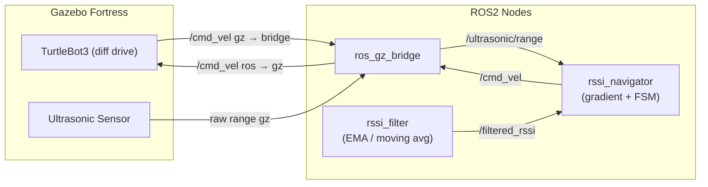

# RF Delivery Bot 🤖☕

> **Mapless indoor café delivery robot using RSSI gradient tracking**
> Built on ROS2 Humble + Gazebo Fortress

The RF Delivery Bot navigates to a Wi-Fi beacon (simulated access point near the delivery target) by following the gradient of received signal strength (RSSI), without requiring a pre-built map. An ultrasonic sensor feeds a multi-phase obstacle avoidance state machine that keeps the robot safe around chairs, tables, and customers.

---

## Table of Contents
1. [Architecture](#architecture)
2. [Prerequisites](#prerequisites)
3. [Build Instructions](#build-instructions)
4. [Running the Simulation](#running-the-simulation)
5. [Topic Reference](#topic-reference)
6. [Obstacle Avoidance State Machine](#obstacle-avoidance-state-machine)
7. [Troubleshooting](#troubleshooting)

---

## Architecture

```
┌─────────────────────────────────────────────────────────────────┐
│                        Gazebo Fortress                          │
│   ┌──────────────┐      ┌──────────────┐      ┌─────────────┐  │
│   │ TurtleBot3   │◄─────│  ros_gz_     │─────►│ Ultrasonic  │  │
│   │ differential │      │  bridge      │      │   sensor    │  │
│   │   drive      │      └──────┬───────┘      └──────┬──────┘  │
│   └──────────────┘             │                     │         │
└───────────────────────────────┼─────────────────────┼─────────┘
                                 │                     │
                    /cmd_vel     │                     │ /ultrasonic/range
                    (ros→gz)     │                     │ (gz→ros)
                                 │                     │
              ┌──────────────────┼─────────────────────┼──────────┐
              │  ROS2 Nodes      │                     │          │
              │                  │                     ▼          │
              │  ┌───────────────▼──┐    ┌──────────────────────┐ │
              │  │  rssi_navigator  │◄───│   rssi_filter        │ │
              │  │                  │    │                       │ │
              │  │ • RSSI gradient  │    │ • EMA / moving-avg   │ │
              │  │   tracking       │    │ • Sim mode (synth.)  │ │
              │  │ • Obstacle FSM   │    │   sinusoidal RSSI    │ │
              │  │   (5-phase)      │    └──────────┬───────────┘ │
              │  └──────────────────┘               │             │
              │          ▲                 /filtered_rssi         │
              │          │                           │             │
              │          └───────────────────────────┘             │
              └────────────────────────────────────────────────────┘
```



---

## Prerequisites

| Dependency | Version | Install |
|---|---|---|
| ROS2 | Humble Hawksbill | [docs.ros.org](https://docs.ros.org/en/humble/Installation.html) |
| Gazebo | Fortress (7.x) | `sudo apt install gz-fortress` |
| ros_gz_bridge | Humble | `sudo apt install ros-humble-ros-gz-bridge` |
| TurtleBot3 packages | Humble | `sudo apt install ros-humble-turtlebot3*` |
| Python | ≥ 3.10 | Included with Ubuntu 22.04 |
| colcon | latest | `pip install colcon-common-extensions` |

> [!IMPORTANT]
> Set the TurtleBot3 model before running: `export TURTLEBOT3_MODEL=burger`

---

## Build Instructions

```bash
# Clone into your workspace (if not already done)
cd ~/ros2_ws/src
git clone <repo-url> rf_delivery_bot

# Install Python dependencies
cd ~/ros2_ws
rosdep install --from-paths src --ignore-src -r -y

# Build with symlink-install (edits to Python files take effect immediately)
colcon build --symlink-install

# Source the workspace overlay
source install/setup.bash
```

---

## Running the Simulation

### Option A — Automated script (recommended)

```bash
# Make executable once
chmod +x src/rf_delivery_bot/scripts/run_simulation.sh

# Run everything: Gazebo, nodes, and bag recording
./src/rf_delivery_bot/scripts/run_simulation.sh
```

The script will:
1. Source ROS2 Humble and the workspace overlay
2. Launch Gazebo + all ROS2 nodes
3. Wait 5 seconds for initialisation
4. Start `ros2 bag record` on the key topics
5. Print the bag output path
6. On **Ctrl+C**: gracefully kill all processes and confirm shutdown

### Option B — Manual launch

```bash
source /opt/ros/humble/setup.bash
source ~/ros2_ws/install/setup.bash

ros2 launch rf_delivery_bot delivery_launch.py
```

### Option C — Individual nodes (debugging)

```bash
# Terminal 1 — Gazebo
gz sim -r ~/ros2_ws/src/rf_delivery_bot/worlds/indoor_delivery.sdf

# Terminal 2 — Bridge
ros2 run ros_gz_bridge parameter_bridge \
    "/ultrasonic/range@sensor_msgs/msg/Range[gz.msgs.LaserScan" \
    "/cmd_vel@geometry_msgs/msg/Twist]gz.msgs.Twist"

# Terminal 3 — RSSI filter (simulation mode)
ros2 run rf_delivery_bot rssi_filter --ros-args -p sim_mode:=true

# Terminal 4 — Navigator
ros2 run rf_delivery_bot rssi_navigator
```

---

## Topic Reference

| Topic | Message Type | Direction | Description |
|---|---|---|---|
| `/raw_rssi` | `std_msgs/Float32` | External → `rssi_filter` | Raw RSSI reading from Wi-Fi hardware / simulator |
| `/filtered_rssi` | `std_msgs/Float32` | `rssi_filter` → `rssi_navigator` | Smoothed RSSI after EMA or moving-average filter |
| `/ultrasonic/range` | `sensor_msgs/Range` | Gazebo → `rssi_navigator` | Obstacle distance from front-facing ultrasonic sensor |
| `/cmd_vel` | `geometry_msgs/Twist` | `rssi_navigator` → Gazebo | Linear/angular velocity commands to the robot |

---

## Obstacle Avoidance State Machine

The navigator implements a **5-phase finite state machine** (enum `AvoidPhase`) that overrides normal RSSI gradient tracking whenever an obstacle is detected.

```
┌─────────┐  range < 0.5 m   ┌──────┐  0.8 s elapsed  ┌─────┐
│  CLEAR  │─────────────────►│ BACK │────────────────►│ ARC │
│(normal  │                  │      │                  │     │
│ travel) │◄──────────────── │-0.15 │                  │arc  │
└─────────┘    RESUME        │ m/s  │                  │turn │
     ▲                       └──────┘                  └──┬──┘
     │                                                    │ 1.5 s
  copy                                                    ▼
  rssi                                               ┌────────┐
     │                                               │ VERIFY │
     │                   ┌──────┐  path clear        │        │
     └───────────────────│RESUME│◄───────────────────│0.08m/s │
                         └──────┘                    │ 0.5 s  │
                                                     └───┬────┘
                                                         │ still blocked
                                                         ▼
                                                    back to BACK
                                                    (flip side)
```

### Phase Descriptions

| Phase | Duration | Behaviour | Purpose |
|---|---|---|---|
| **CLEAR** | Continuous | RSSI gradient tracking; forward 0.22 m/s or search sweep | Normal delivery navigation |
| **BACK** | 0.8 s | Reverse at −0.15 m/s | Gain clearance from obstacle |
| **ARC** | 1.5 s | Arc turn (angular ±0.5 rad/s, linear 0.1 m/s) | Steer around obstacle |
| **VERIFY** | 0.5 s | Creep forward at 0.08 m/s | Confirm path is now clear |
| **RESUME** | 1 step | Copy `latest_rssi → previous_rssi`; re-enter CLEAR | Reset gradient baseline to avoid false reversal |

**Threat-side alternation**: The robot tracks a `_threat_side` variable (`'left'` / `'right'`). Each new obstacle encounter flips the side, so if the robot is repeatedly obstructed it systematically tries both directions instead of looping.

---

## Troubleshooting

### Gazebo not found / `gz: command not found`

```bash
# Verify Gazebo Fortress is installed
gz sim --version

# If missing, install it:
sudo apt update
sudo apt install gz-fortress
```

Also ensure the `GZ_VERSION` environment variable is set to `fortress` if you have multiple Gazebo versions installed.

---

### RSSI not publishing on `/filtered_rssi`

1. **Check sim_mode**: The node must be launched with `sim_mode:=true` (the launch file does this automatically) when real Wi-Fi hardware is absent.
2. **Inspect the topic**:
   ```bash
   ros2 topic echo /filtered_rssi
   ros2 topic hz /filtered_rssi   # expect ~1 Hz in sim mode
   ```
3. **Check node is running**:
   ```bash
   ros2 node list   # should show /rssi_filter
   ros2 node info /rssi_filter
   ```
4. **Filter stale warning**: If the node logs `"No RSSI data for >2 s — republishing last known value"`, real hardware is not publishing to `/raw_rssi`. Enable `sim_mode` or connect Wi-Fi hardware.

---

### Robot is stuck / not moving

1. **Check `/cmd_vel`**:
   ```bash
   ros2 topic echo /cmd_vel
   ```
   If nothing is published, the navigator is not running or `/filtered_rssi` is not arriving.

2. **Obstacle avoidance loop**: If the robot keeps backing up without progressing, the `_threat_side` alternation should break the loop. Check logs:
   ```bash
   ros2 node info /rssi_navigator
   # or watch stdout in the launch terminal for state transition logs
   ```

3. **Bridge not running**: Ensure `/ultrasonic/range` is bridged:
   ```bash
   ros2 topic list | grep ultrasonic
   ros2 topic hz /ultrasonic/range
   ```

4. **World not loaded**: If Gazebo opens but no robot appears, check the SDF path:
   ```bash
   find ~/ros2_ws -name indoor_delivery.sdf
   ros2 pkg prefix rf_delivery_bot
   ```

5. **Re-build after changes**:
   ```bash
   cd ~/ros2_ws
   colcon build --symlink-install
   source install/setup.bash
   ```

---

## License

Apache-2.0 © delivery_bot_team
